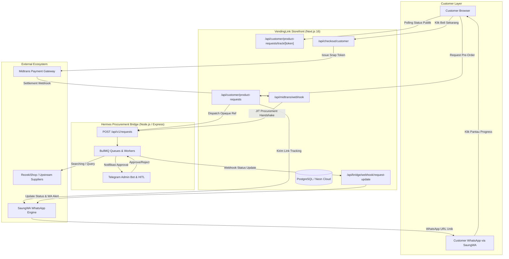

# 🏛️ Architecture & System Design — VendingLink Storefront

Selamat datang di dokumentasi arsitektur sistem **VendingLink Storefront**. Dokumen ini merangkum arsitektur teknis menyeluruh, batas tanggung jawab sistem (*architectural boundaries*), alur data, model keamanan, serta subsistem pengadaan on-demand berbasis agen.

---

## 📐 Arsitektur Tingkat Tinggi

VendingLink dirancang dengan arsitektur **decoupled micro-service boundary** antara **Storefront** (repo ini) dan **Hermes Bridge** (`vendinglink_bridge`), berinteraksi secara asinkron melalui webhook terautentikasi dan antrean BullMQ.

---

## 🧱 4 Pilar Utama Sistem

### 1. Storefront Retail & Manajemen Stok Otomatis
- **Katalog Realtime:** Pengelolaan produk digital (lisensi software, voucher, akun streaming).
- **Stok Fisik vs On-Demand:** Pemenuhan stok otomatis dari `RedeemStock` (stok tersedia) atau eskalasi ke `ProductRequest` (on-demand pre-order).
- **Payment Gateway Gateway-Agnostic:** Integrasi Midtrans (QRIS, GoPay, VA Bank) dengan fail-closed audit log.

### 2. Promo Engine & Loyalty Terpadu
- **Referral 1-Tingkat:** Pelanggan memiliki kode referral unik 13 karakter; komisi dicatat di buku besar `CustomerCredit`.
- **Masa Tunggu 15 Hari:** Status akrual `ACCRUED` naik menjadi `PAYABLE` secara otomatis setelah window rekonsiliasi bebas sengketa.
- **Voucher Berjadwal:** Engine diskon server-side dengan verifikasi waktu UTC ketat dan pembatasan kuota atomik.

### 3. On-Demand Pre-Order & Live Tracking Subsystem (Sprint P2a)
- **Zero-Login Public Tracking:** Halaman tracking live `/pre-order/track/[trackingToken]` dengan token opaque aman tanpa mengharuskan login akun.
- **Supplier Privacy & Zero-Exposure:** Data supplier (`quotedPrice` / HPP modal, kode supplier `RZK`, SKU supplier) diisolasi 100% dari customer.
- **Margin Laba Terkunci:** Customer selalu ditagih harga jual katalog (`product.price`).
- **Pemanis Marketing 40% Anchor:** Formula perhitungan harga coret acuan diskon 40% otomatis (`getPreOrderDisplayPrices`).
- **Penyeragaman Identitas Publik:** Pelanggan hanya melihat identitas **"bagian Purchasing kami"** (Hermes / nama internal disembunyikan).
- **Bypass Stok Checkout & JIT Handshake:** Checkout dengan parameter `requestId` mem-bypass guard stok fisik lokal untuk status `STOCKED`, menautkan `orderId`, dan mengeksekusi pembelian riil ke upstream begitu pembayaran `PAID`.

### 4. Anti-Abuse & Guardrails
- **Deduplikasi Pre-Order:** Pelanggan dibatasi maksimal 1 pre-order aktif per nomor WhatsApp (`getActivePreOrderForPhone`).
- **In-Stock Redirect Guard:** Jika produk yang diminta sudah memiliki stok fisik riil di `RedeemStock`, sistem secara otomatis mengarahkan pelanggan langsung ke checkout (`checkExistingStockRedirect`).
- **Audit Logging:** Siklus hidup tracking token (dibuat, diakses, dihapus/dipenuhi) dicatat ke `lib/audit/trackingAudit.ts`.

---

## 📚 Dokumen Spesifikasi Terperinci

| Dokumen | Deskripsi | Target Pembaca |
|---------|-----------|----------------|
| [System Design](./system-design.md) | Desain mendalam sistem, diagram interaksi, alur status pre-order, dan siklus transaksi | Lead Dev, System Architect |
| [API Architecture](./api-architecture.md) | Spesifikasi lengkap seluruh endpoint REST API Storefront & Webhook Bridge | Backend / Frontend Engineer |
| [Database Schema](./database-schema.md) | Dokumentasi skema tabel Prisma, relasi, enum, indeks, dan integritas data | DB Admin, Backend Engineer |
| [Tech Stack](./tech-stack.md) | Detail pilihan teknologi, dependensi inti, dan alasan pemilihan | Seluruh Tim Engineering |
| [Directory Structure](./directory-structure.md) | Panduan struktur direktori, konvensi penempatan file, dan peta codebase | Developer Baru / AI Agent |

---

## 🛡️ Batas Arsitektur (Architectural Boundaries)

| Storefront (`vendinglink`) | Hermes Bridge (`vendinglink_bridge`) |
|----------------------------|---------------------------------------|
| ✅ UI Katalog & Halaman Tracking | ❌ UI Customer & Web Server Publik |
| ✅ PII Pelanggan (Nomor WhatsApp, Nama) | ❌ Tidak boleh menyimpan PII Pelanggan |
| ✅ Penagihan Harga Jual Retail (`product.price`) | ✅ Eksekusi Pembelian Modal (`quotedPrice`) |
| ✅ Validasi Kuota Promo & Referral | ❌ Tidak mengurus Diskon/Voucher |
| ✅ Integrasi Midtrans & Kasir Kasir | ❌ Tidak berinteraksi dengan Payment Gateway |
| ❌ Tidak memanggil API Supplier Langsung | ✅ Adapter Supplier Dinamis (RezekiShop, dll) |
| ❌ Tidak menyimpan kunci lisensi mentah | ✅ Enkripsi Kunci AES-256-GCM & BullMQ Queue |

---

**See Also:** [← Back to Main Docs](../README.md) | [Agent Guides](../agent-guides/README.md) | [Roadmap](../initiatives/ROADMAP.md)  
**Terakhir Diperbarui:** 2026-10-17
