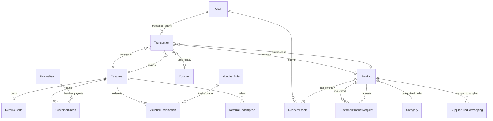

# 🗄️ Database Schema — VendingLink Storefront

Dokumentasi lengkap skema basis data PostgreSQL yang dikelola menggunakan Prisma ORM (`prisma/schema.prisma`).

---

## 1. Diagram Relasi Entitas (ERD)

---

## 2. Model Pre-Order & Pengadaan On-Demand

### `CustomerProductRequest` (`customer_product_requests`)
Menyimpan siklus hidup permintaan pre-order on-demand pelanggan saat stok fisik habis.

| Kolom | Tipe | Constraint / Default | Deskripsi |
|-------|------|----------------------|-----------|
| `id` | `String` | `@id @default(cuid())` | Primary key unik CUID |
| `trackingToken` | `String?` | `@unique` | Token publik acak (`trk_...`) untuk tracking tanpa login |
| `bridgeRequestId` | `String?` | `@unique` | ID korelasi dengan Hermes Bridge |
| `customerPhone` | `String` | `NOT NULL` | Nomor WhatsApp customer yang ternormalisasi (`628...`) |
| `customerRef` | `String` | `NOT NULL` | Opaque customer reference untuk Bridge (tanpa PII) |
| `productId` | `String?` | Relasi `Product.id` | ID produk yang diminta |
| `productName` | `String` | `NOT NULL` | Snapshot nama produk |
| `categorySlug` | `String?` | `NULL` | Slug kategori produk |
| `maxBudget` | `Float?` | `NULL` | Batas anggaran pelanggan |
| `status` | `String` | `@default("SEARCHING")` | Status siklus hidup (`PENDING_SOURCING`, `AGENT_PURCHASING`, `STOCKED`, `ORDERED`, `FULFILLED`, `NOT_FOUND`, `CANCELLED`) |
| `quotedPrice` | `Float?` | `NULL` | **HPP modal dari supplier (Strict Internal - Dilarang diekspos ke customer)** |
| `foundSupplierCode` | `String?` | `NULL` | **Kode supplier hulu (misal: RZK) - Dilarang diekspos ke customer** |
| `foundProductId` | `String?` | `NULL` | **SKU supplier hulu - Dilarang diekspos ke customer** |
| `rejectionReason` | `String?` | `NULL` | Alasan jika request dibatalkan/ditolak |
| `transactionId` | `String?` | `NULL` | Korelasi ID transaksi pembelian retail setelah customer checkout |
| `notifiedAt` | `DateTime?` | `NULL` | Waktu notifikasi WhatsApp terakhir terkirim |
| `confirmedAt` | `DateTime?` | `NULL` | Waktu konfirmasi beli |
| `paymentType` | `String` | `@default("PAY_ON_CONFIRM")` | Tipe pembayaran (`PAY_ON_CONFIRM` \| `PAYMENT_FIRST`) |
| `paymentStatus` | `String` | `@default("UNPAID")` | Status bayar (`UNPAID` \| `PENDING` \| `PAID` \| `REFUNDED`) |
| `paymentAmount` | `Float?` | `NULL` | Nominal bayar |
| `paymentInvoiceUrl` | `String?` | `NULL` | Link invoice |
| `expiresAt` | `DateTime?` | `NULL` | Waktu kadaluarsa penawaran stok |
| `isInvalidated` | `Boolean` | `@default(false)` | Flag invalidasi |
| `createdAt` | `DateTime` | `@default(now())` | Waktu dibuat |
| `updatedAt` | `DateTime` | `@updatedAt` | Waktu pembaruan terakhir |

**Indeks:**
- `@@index([trackingToken])` — Akses cepat pembacaan live tracking oleh publik.
- `@@index([customerPhone])` — Evaluasi guard deduplikasi pre-order aktif per nomor telepon.
- `@@index([status, createdAt])` — Query filtering antrean pencarian.
- `@@index([customerRef])` — Resolusi opaque reference dari Bridge.

---

## 3. Model Katalog, Inventaris, & Stok

### `Product` (`products`)
Menyimpan katalog item produk digital (lisensi, voucher, akun).

| Kolom | Tipe | Default / Keterangan |
|-------|------|----------------------|
| `id` | `String` | Primary key CUID |
| `name` | `String` | Nama produk |
| `price` | `Int` | Harga jual retail dalam Rupiah (basis penagihan customer) |
| `originalPrice` | `Int?` | Harga acuan sebelum diskon |
| `showOriginalPrice` | `Boolean` | `@default(true)` |
| `type` | `String` | `'LINK'` (redeem link) \| `'KODE'` (voucher code) |
| `description` | `String?` | Deskripsi produk |
| `guideImageUrl` | `String?` | Gambar panduan aktivasi |
| `guideText` | `String?` | Teks instruksi langkah penggunaan |
| `isActive` | `Boolean` | `@default(true)` |
| `supplierMode` | `String` | `@default("MANUAL")` (semua produk menggunakan pasokan asinkron) |
| `supplierProductId` | `String?` | ID produk hulu opsional |
| `categoryId` | `String?` | Relasi ke `Category` |

### `RedeemStock` (`redeem_stocks`)
Item fisik stok digital yang dapat diklaim oleh pembeli atau agen.

| Kolom | Tipe | Keterangan |
|-------|------|------------|
| `id` | `String` | Primary key CUID |
| `productId` | `String` | Foreign key ke `Product` |
| `redeemUrl` | `String` | URL redeem / lisensi unik |
| `status` | `String` | `'AVAILABLE'` \| `'SOLD'` |
| `source` | `String` | `'MANUAL'` (upload CSV admin) \| `'BRIDGE'` (topup otomatis Bridge) |
| `claimedByAgentId` | `String?` | User ID jika diklaim agen |
| `claimedAt` | `DateTime?` | Waktu pengklaiman |

---

## 4. Model Transaksi & Pembayaran

### `Transaction` (`transactions`)
Merekam seluruh pesanan retail (B2C) maupun transaksi kredit agen (B2B).

- **`orderId`:** String unik acak (`TRX-YYYYMMDD-XXXXXX`).
- **`productId`:** Relasi ke `Product`.
- **`paymentType`:** `'MIDTRANS'` \| `'AGENT_CREDIT'` \| `'FREE_PROMO'`.
- **`status`:** `'PENDING'` \| `'PAID'` \| `'EXPIRED'` \| `'CANCELLED'`.
- **`stockStatus`:** `'PENDING'` \| `'FULFILLED'` \| `'OUT_OF_STOCK'`.
- **`finalAmount`:** Nominal akhir yang ditagihkan kepada customer setelah diskon.
- **`redeemUrl`:** Lisensi yang diserahkan kepada pembeli setelah berstatus `PAID`.
- **`snapToken`:** Token pembayaran Midtrans Snap.

---

## 5. Model Promo, Referral, & Komisi

### `Customer` (`customers`)
- `phone`: Nomor WhatsApp dinormalisasi unik (`628xxx`).
- `consentPromoAt`: Timestamp persetujuan menerima info promo & marketing.

### `ReferralCode` (`referral_codes`)
- `code`: String 13 karakter unik.
- `customerId`: Relasi 1-to-1 dengan Customer.

### `CustomerCredit` (`customer_credits`)
Buku besar akrual komisi referral dan kompensasi refund stockout.
- `kind`: `'REFERRAL_COMMISSION'` \| `'STOCKOUT_REFUND'`.
- `status`: `'ACCRUED'` ➔ `'PAYABLE'` (setelah 15 hari masa tunggu) ➔ `'PAID'`.
- `payoutBatchId`: Relasi ke batch pencairan dana GoPay/OVO manual.

### `VoucherRule` (`voucher_rules`) & `VoucherRedemption` (`voucher_redemptions`)
Engine diskon terjadwal server-side dengan verifikasi kuota per customer atomik.

---

## 6. Model Integrasi & Konfigurasi Eksternal

- **`SupplierProductMapping`:** Relasi mapping antara `(supplierCode, supplierProductId)` dan `productId` Storefront.
- **`BridgeInboundEvent`:** Log idempotensi event topup stok yang diterima dari Hermes Bridge.
- **`AIConfiguration`:** Pengaturan provider AI (OpenRouter, 9Router, model Claude/GPT, API key terenkripsi).
- **`GoogleDriveConfig`:** Konfigurasi Service Account Google Drive untuk backup dan export laporan transaksi.

---

**See Also:** [System Design](./system-design.md) | [API Architecture](./api-architecture.md)
