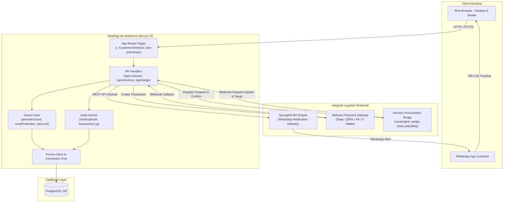
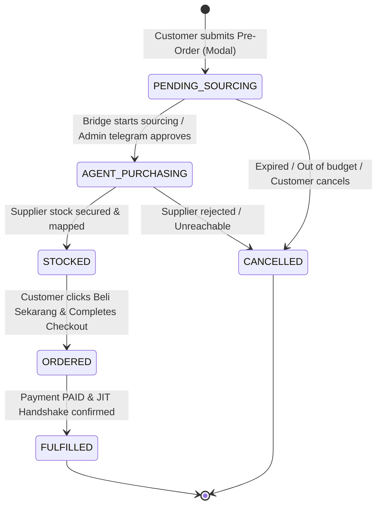

# 🏛️ System Design — VendingLink Storefront

**Spesifikasi Desain Sistem & Siklus Transaksi On-Demand Pre-Order**  
**Terakhir Diperbarui:** 2026-10-17  
**Owner:** Storefront Engineering Team  

---

## 1. Arsitektur Komponen & Ekosistem

VendingLink Storefront dibangun di atas fondasi **Next.js 16 (App Router)** dengan PostgreSQL sebagai database relasional utama. Sistem ini beroperasi secara otonom untuk transaksi katalog retail, serta terhubung dengan ekosistem mikroservis dan pihak ketiga untuk pengadaan stok dinamis:



---

## 2. Subsistem On-Demand Pre-Order Lifecycle

Subsistem On-Demand Pre-Order dirancang untuk menangani permintaan produk saat stok fisik di etalase toko sedang habis (`out of stock`), memungkinkan pengadaan stok otomatis secara Just-In-Time (JIT) tanpa mengecewakan pembeli.

### 2.1 State Machine Diagram



### 2.2 Tahapan Siklus Lengkap (End-to-End Walkthrough)

#### Tahap 1: Pengajuan Pre-Order & Guard Anti-Abuse
1. **Pemicu:** Pelanggan menekan tombol "Request Produk ini" pada kartu produk kosong di katalog.
2. **Modal Form (`RequestProductModal.tsx`):**
   - Pelanggan mengisi nomor WhatsApp (format `08...`, `628...`, atau `+628...`).
   - Nomor dinormalisasi ke standar internasional tanpa tanda plus: `628xxx` (`lib/whatsapp.ts`).
3. **Pemeriksaan Guard (`lib/guards/preorderGuard.ts`):**
   - **Guard 1 (Deduplikasi):** `getActivePreOrderForPhone(normalizedPhone)` memeriksa apakah pelanggan memiliki pre-order aktif berkategori `PENDING_SOURCING`, `AGENT_PURCHASING`, atau `STOCKED`. Jika ada, request ditolak dengan HTTP 409 Conflict.
   - **Guard 2 (Stok Tersedia):** `checkExistingStockRedirect(productId)` memeriksa apakah ada stok fisik `AVAILABLE` di tabel `RedeemStock`. Jika ada stok riil, request pre-order ditolak dan pelanggan diarahkan langsung ke halaman checkout.
4. **Pembuatan Token Opaque Unik:**
   - Sistem membangkitkan token unik kriptografis: `trk_${crypto.randomBytes(16).toString("hex")}`.
   - Record `ProductRequest` disimpan ke database dengan status awal `PENDING_SOURCING`.
   - Audit trail dicatat via `recordTrackingEvent("CREATED", ...)`.
5. **Dispatching Asinkron:**
   - **Ke Hermes Bridge:** Mengirim opaque reference ID (`POST {BRIDGE_URL}/api/v1/requests`) tanpa membocorkan PII pelanggan.
   - **Ke SaungWA:** Mengirim pesan WhatsApp konfirmasi instan beserta link tracking langsung ke nomor pelanggan:  
     `https://storefront.domain/pre-order/track/[trackingToken]`.

#### Tahap 2: Live Tracking Tanpa Login (Public Tracking Route)
1. **Akses URL:** Pelanggan membuka URL unik dari WhatsApp.
2. **Route Protection Bypass (`lib/routeProtection.ts`):**
   - Prefix `/pre-order/track/` didaftarkan sebagai rute publik bebas autentikasi, sehingga pelanggan tidak diarahkan ke halaman login.
3. **Data Fetching & Supplier Privacy Boundary (`/api/customer/product-requests/track/[trackingToken]`):**
   - Endpoint mencari `ProductRequest` berdasarkan `trackingToken`.
   - **Strict Redaction:** Seluruh field modal supplier (`quotedPrice`, `foundSupplierCode`, `foundProductId`) dihapus dari payload JSON yang dikirim ke browser.
   - **Penetapan Harga Katalog:** Nilai `estimatedPrice` diisi dengan harga jual katalog toko (`product.price`).
   - **Anchor Diskon 40% (`lib/utils.ts`):** `getPreOrderDisplayPrices(product.price)` menghitung harga coret acuan (pemanis pemasaran):
     $$\text{strikethroughPrice} = \text{round}\left(\frac{\text{price}}{0.6 \times 1000}\right) \times 1000$$
4. **Branding Pelanggan:**
   - Seluruh teks antarmuka dan status indikator menggunakan nama **"bagian Purchasing kami"** (identitas teknis Hermes disembunyikan).
   - Indikator status live memberikan estimasi pengerjaan dan timeline proses pencarian.

#### Tahap 3: Notifikasi Stok Siap & Navigasi Checkout
1. **Update dari Bridge:** Saat supplier mengonfirmasi ketersediaan barang atau admin menyetujui mapping di Telegram, Bridge mengirim webhook `POST /api/bridge/webhook/request-update` dengan status `STOCKED` (atau `FOUND`).
2. **Notifikasi WhatsApp:** SaungWA mengirim notifikasi ke WhatsApp pelanggan: *"Kabar baik! Produk Anda telah siap. Klik link untuk melanjutkan pembelian..."*.
3. **Halaman Tracking:** State berubah menjadi `STOCKED`, menampilkan tombol utama **"BELI SEKARANG"** yang mengarahkan pembeli ke:
   ```
   /customer/checkout/[productId]?requestId=[requestId]
   ```

#### Tahap 4: Checkout Integration & Zero-Stock Bypass
1. **Bypass Guard Stok:**
   - Secara default, `/api/checkout/customer` memeriksa keberadaan minimal 1 item `RedeemStock` berstatus `AVAILABLE`.
   - Jika terdapat parameter `requestId`, sistem memvalidasi bahwa `requestId` tersebut berstatus `STOCKED`, cocok dengan `productId`, dan belum dikaitkan dengan order lain.
   - Validasi stok fisik lokal dilewati karena stok akan dipenuhi melalui pengadaan JIT.
2. **Penetapan Harga Final:**
   - Tagihan yang dibuat ke Midtrans tetap mengacu pada `product.price` (bukan harga supplier), menjaga margin laba toko 100% utuh.
3. **Koneksi Transaksi:**
   - Order dibuat di tabel `Transaction`.
   - Kolom `ProductRequest.orderId` ditautkan ke ID transaksi tersebut.

#### Tahap 5: Settlement & JIT Procurement Handshake
1. **Midtrans Webhook (`/api/midtrans/webhook`):**
   - Menerima notifikasi status pembayaran `settlement` atau `capture`.
   - Memperbarui status transaksi menjadi `PAID`.
   - Memanggil `fulfillProductRequest(transaction.id)`:
     - Mengubah status `ProductRequest` menjadi `ORDERED` / `FULFILLED`.
     - Mengirim notifikasi tanda terima dan panduan ke WhatsApp pembeli.
     - Mengeksekusi handshake asinkron ke Hermes Bridge:  
       `confirmBridgeRequest(productRequest.id)` untuk memicu eksekusi pengadaan riil upstream.
     - Mencatat audit event `TRACKING_TOKEN_FULFILLED`.

---

## 3. Invarian Arsitektur & Keamanan (Non-Negotiable Invariants)

| Invarian | Implementasi Teknis | Dampak Jika Dilanggar |
|----------|---------------------|-----------------------|
| **Zero Supplier Exposure** | Endpoint tracking publik meredaksi `quotedPrice`, `foundSupplierCode`, dan `foundProductId`. | Pelanggan mengetahui supplier asli dan harga modal toko (kebocoran rahasia dagang). |
| **Gross Profit Preservation** | Checkout hanya menagih `product.price` katalog. | Kerugian finansial fatal (toko menjual dengan harga modal supplier). |
| **Zero-Login Public Access** | Token acak 32-karakter hexa (`trk_...`) dengan routing publik tanpa sesi NextAuth. | Pelanggan dipaksa login / registrasi, menyebabkan drop-off konversi 80%+. |
| **Deduplikasi Pre-Order** | Query DB `getActivePreOrderForPhone()` membatasi 1 request aktif per nomor WhatsApp. | Pelanggan dapat membanjiri request spam dan membebani kuota pengadaan agen. |
| **Physical Stock Redirection** | `checkExistingStockRedirect()` memaksa checkout langsung jika stok fisik `AVAILABLE` > 0. | Terjadi pre-order ganda yang tidak perlu saat stok sebenarnya sudah ada di gudang. |
| **Public Agent Branding** | Penamaan publik strictly "bagian Purchasing kami". | Kebingungan pelanggan terhadap istilah teknis AI / nama bot eksternal. |

---

## 4. Audit Trail & Ketahanan Data

Sistem pencatatan audit pelacakan (`lib/audit/trackingAudit.ts`) beroperasi secara independen dari log aplikasi umum:

- **Struktur Audit Log:**
  ```typescript
  interface TrackingAuditEvent {
    eventType: "CREATED" | "ACCESSED" | "FULFILLED" | "EXPIRED" | "CANCELLED";
    trackingToken: string;
    requestId: string;
    productId: string;
    phoneNormalized?: string;
    timestamp: Date;
    metadata?: Record<string, unknown>;
  }
  ```
- **Ketahanan (Resilience):** Setiap transisi status pre-order dilindungi oleh transaksi DB atomik (`$transaction`) untuk mencegah *race conditions* saat beberapa webhook atau request checkout tiba bersamaan.

---

**See Also:** [API Architecture](./api-architecture.md) | [Database Schema](./database-schema.md) | [Agent Guides](../agent-guides/README.md)
