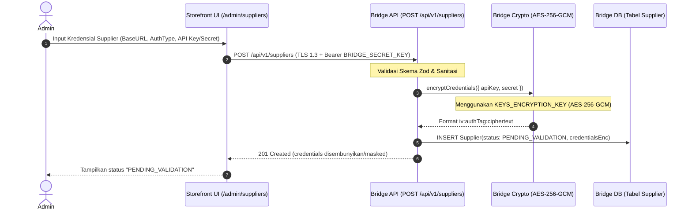

# Spesifikasi Ownership & Enkripsi Kredensial Supplier (ST-P2b-2)

Dokumen ini mendefinisikan batasan arsitektur, kepemilikan enkripsi (*encryption ownership*), dan mekanisme perlindungan kredensial pihak ketiga (API Key, Secret Key, Token) untuk **Sprint P2b — Dynamic Supplier Management**.

---

## 1. Keputusan Kepemilikan Enkripsi (Encryption Ownership)

* **Pemilik Utama Enkripsi:** **VendingLink Bridge Engine (Server-Side)**.
* **Tanggung Jawab Storefront:** **Stateless Management Client**.

### Rasio & Pertimbangan Arsitektur:
1. **Separation of Concerns:** Bridge adalah entitas yang melakukan interaksi HTTP langsung dengan vendor/supplier saat pencarian produk (`productSearchWorker`) dan eksekusi pembelian (`supplierOrderQueue`). Menempatkan kunci dekripsi di Storefront akan menyebabkan kebocoran boundary arsitektur.
2. **Zero Blast Radius:** Storefront di Vercel tidak menyimpan `KEYS_ENCRYPTION_KEY` master di environment production. Jika terjadi kompromi pada frontend atau session admin storefront, penyerang tidak dapat mendekripsi database kredensial supplier.
3. **Decoupled Key Lifecycle:** Rotasi kunci enkripsi dilakukan secara lokal di Bridge tanpa perlu deploy ulang Storefront di Vercel.

---

## 2. Diagram Alur Data & Kriptografi



---

## 3. Spesifikasi Teknis Kriptografi

1. **Algoritma:** `AES-256-GCM` (Galois/Counter Mode — Authenticated Encryption with Associated Data).
2. **Panjang Kunci:** 32 Bytes (256-bit), dimuat dari environment variable `KEYS_ENCRYPTION_KEY` (format Base64).
3. **Inisialisasi Vektor (IV):** 12 Bytes cryptographically random (`crypto.randomBytes(12)`) per-enkripsi.
4. **Authentication Tag:** 16 Bytes GCM Auth Tag untuk mencegah *tampering* / *ciphertext manipulation*.
5. **Format Serialisasi di Database (`Supplier.credentialsEnc`):**
   ```text
   <hex_iv>:<hex_auth_tag>:<hex_ciphertext>
   ```

---

## 4. Batasan Keamanan Mutlak (Zero-Leakage Rules)

1. **Tidak Ada Plaintext di Database:** Kolom database `Supplier.credentialsEnc` hanya menyimpan string ciphertext terautentikasi.
2. **Masking pada API Respon:**
   - Endpoint `GET /api/v1/suppliers` dan `GET /api/v1/suppliers/:code` **DILARANG** mengembalikan nilai kredensial plaintext.
   - Respons hanya mengembalikan metadata status:
     ```json
     {
       "code": "DIGIFLAZZ",
       "displayName": "Digiflazz Official",
       "authType": "API_KEY",
       "hasCredentials": true,
       "maskedKey": "sk_live_****3a9f",
       "status": "ACTIVE"
     }
     ```
3. **LLM Redaction Filter (Hermes Agent Boundary):**
   - Jika `GenericRestAdapter` gagal dan task dialihkan ke LLM Builder (Fase 3), seluruh kredensial riil **wajib disaring oleh Sanitizer** menjadi `<MOCK_API_KEY>` dan `<MOCK_SECRET>` sebelum dikirim ke prompt LLM (Claude/GPT-4o).
   - Kredensial riil tidak pernah keluar ke server pihak ketiga penyedia AI.
